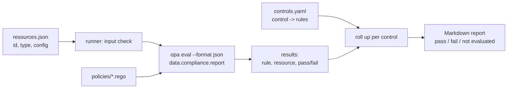

# OPA compliance engine with a Python runner

Six Rego rules that check cloud resource configurations, a YAML file that
maps those rules to SOC 2 and ISO/IEC 27001 control IDs, and a thin Python
runner that calls `opa eval` and writes a Markdown report with **pass**,
**fail** or **not evaluated** for each control.

> **Not an audit.** The control mapping is illustrative. A passing report
> is not an attestation, an audit result, or a SOC 2 / ISO 27001
> certification, and no auditor has reviewed the mapping.

> **Status:** the Rego rules are covered by 14 `opa test` cases (pass and
> fail for each rule). The runner is covered by 16 pytest tests: they call
> the real pinned `opa` binary on fixtures, and they fake `subprocess` for
> the error paths. The input is a normalised JSON file; **no live cloud
> collection is built**. Nothing has run against a real account.

## Problem

> Build a Python-based policy engine (OPA/Rego or pure Python) that
> evaluates cloud resource configurations against an internal compliance
> framework (SOC2, ISO 27001 controls).

## How it works



### Rules (`policies/compliance.rego`)

| Rule | Applies to | Fails when |
|---|---|---|
| `s3_public_access_blocked` | `aws_s3_bucket` | any of the four public access block settings is not `true` |
| `s3_access_logging` | `aws_s3_bucket` | server access logging is not enabled |
| `storage_encrypted` | `aws_s3_bucket`, `aws_ebs_volume`, `aws_db_instance` | encryption at rest is not `true` |
| `sg_no_open_admin_ports` | `aws_security_group` | port 22 or 3389 is open to `0.0.0.0/0` or `::/0`, including inside a range |
| `iam_console_user_mfa` | `aws_iam_user` with console access | MFA is not enabled |
| `cloudtrail_multi_region` | `aws_cloudtrail` | the trail is not logging or not multi-region |

A missing setting counts as a failure, never as a pass.

### Control roll-up (`controls.yaml`)

- **fail:** at least one mapped rule failed on some resource.
- **pass:** mapped rules produced results and all of them passed.
- **not evaluated:** no resource in the input was in scope for any mapped
  rule. This is reported, not counted as a pass.

The mapping covers SOC 2 CC6.1, CC6.7, CC7.2 and ISO/IEC 27001:2022 Annex A
5.15, 8.5, 8.15 and 8.24. It is an example of how to structure the mapping.
A mapping that names a rule the policy doesn't define is an error.

## Input format

```json
{"resources": [
  {"id": "vol-0123456789abcdef0", "type": "aws_ebs_volume", "config": {"encrypted": false}}
]}
```

A collector that turns AWS Config or `terraform show -json` output into this
shape is **not built**. See `tests/fixtures/` for examples.

## Usage

```bash
# opa v1.22.4: download it and check its sha256 (the CI workflow shows how)
opa fmt --fail --list policies
opa check --strict policies
opa test -v policies

python -m pip install -r requirements-dev.txt
python -m ruff check .
python -m ruff format --check .
OPA_BIN=$(command -v opa) python -m pytest -q

python -m compliance --input tests/fixtures/resources.json --output report.md
python -m compliance --input resources.json --opa /usr/local/bin/opa --fail-on-fail
```

| Exit code | Meaning |
|---|---|
| 0 | report written |
| 1 | opa missing, opa error (parse error, bad query), undefined result, bad input or bad mapping |
| 2 | report written, `--fail-on-fail` set, and at least one control failed |

The pytest suite needs the real `opa`. If it is not found, the tests fail;
they are never skipped.

## Limits

- Six example rules, AWS-shaped input only.
- No collector: the input JSON is supplied by you.
- Each control maps to whole rules; there is no weighting, no evidence
  storage, no exceptions or risk acceptance workflow.
- The mapping is illustrative and incomplete for both frameworks.

## Security notes

- Read-only: it reads two local files and runs `opa eval` without network
  access. No credentials are used.
- The report can reveal weaknesses; treat it like any security finding.
- CI downloads `opa` and checks its sha256 before running it.
